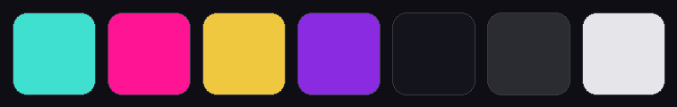

<div align="center">

# 🌙 dreamtheme

**One brand palette, every tool.** Jinchi's personal theme — collected across
the terminal, the editor, the multiplexer, and everything in between.



</div>

## Palette

| | Color | Hex | Role |
|:--:|:--|:--|:--|
|  | **turquoise** | `#40E0D0` | primary · focus · selection |
|  | **deeppink** | `#FF1493` | accent · highlights · errors |
|  | **amber** | `#F0C840` | accent · warnings |
|  | **blueviolet** | `#8A2BE2` | accent · gradient midpoint |
|  | **ink** | `#14141C` | canvas (dark) |
|  | **off-white** | `#E5E5EA` | text |
|  | **surface** | `#2B2B32` | panels · separators |

<details>
<summary>Supplementary (midnight) hues</summary>

| | Color | Hex |
|:--:|:--|:--|
|  | teal | `#5EEAD4` |
|  | pink | `#FBCFE8` |
|  | lavender | `#A78BFA` |

</details>

**Fonts:** [Geist](https://vercel.com/font) (sans) / Geist Mono (mono). Fonts are set
by each app/terminal — the theme files only control color.

## Install

On any machine:

```bash
git clone https://github.com/jinchiwei/dreamtheme.git ~/dreamtheme   # or: cd ~/dreamtheme && git pull
cd ~/dreamtheme && ./install.sh          # symlink drop-in themes (--copy to copy instead)
```

`install.sh` symlinks the drop-in themes into place (backing up any existing file to
`.bak`), patches the Warp background-image path to your home, then prints the per-tool
**activate** lines and the **manual-merge** steps for the snippet-based tools. Symlinks
auto-update on `git pull`.

## Supported apps

| App | File(s) | Install / activate |
|:--|:--|:--|
| **zellij** | `zellij/dreamtheme.kdl` | → `~/.config/zellij/themes/`, set `theme "dreamtheme"` |
| **vim** | `vim/dreamTheme.vim`, `vim/dreamThemeArc.vim` | → `~/.vim/colors/`, `:colorscheme dreamTheme` |
| **vim-airline** | `vim/airline/dreamtheme.vim` | → `~/.vim/autoload/airline/themes/`, `let g:airline_theme='dreamtheme'` |
| **neovim** (LazyVim) | `nvim/user-colorscheme.lua`, `nvim/lualine/dreamTheme.lua`, plus the vim colorschemes | → `~/.config/nvim/` (`lua/plugins/`, `lua/lualine/themes/`, `colors/`) |
| **ranger** | `ranger/dreamtheme.py` | → `~/.config/ranger/colorschemes/`, `set colorscheme dreamtheme` |
| **glow** | `glow/dreamtheme.json` | → `~/.config/glow/`, `glow -s dreamtheme.json` |
| **television** | `television/dreamtheme.toml` | → `~/.config/television/themes/` |
| **yazi** | `yazi/dreamtheme.toml`, `yazi/dreamtheme-icons.py` | → `~/.config/yazi/theme.toml` (icons recolored too, see Notes) |
| **btop** | `btop/dreamtheme.theme` | → `~/.config/btop/themes/`, `color_theme = "dreamtheme"` |
| **visidata** | `visidata/dreamtheme.visidatarc` | → `~/.visidatarc` |
| **zsh** | `zsh/dreamingmachine.zsh-theme` | → `~/.oh-my-zsh/custom/themes/`, `ZSH_THEME="dreamingmachine"` |
| **bash** | `bash/dreamtheme.bash` | `source` it from `~/.bashrc` |
| **obsidian** | `obsidian/dreamtheme.css` | → `<vault>/.obsidian/snippets/`, enable in Appearance |
| **warp** | `warp/Jellyfish DM.yaml` + `jellyfish_bg.jpg` | → `~/.warp/themes/`, pick in Settings → Appearance |
| **ghostty** | `ghostty/Andromeda`, `ghostty/config` | theme → `~/.config/ghostty/themes/`; merge `config` (font, palette, selection) by hand |
| **herdr** | `herdr/config.toml` | → `~/.config/herdr/config.toml` if none exists, then `herdr server reload-config` |
| **herdr-app** | `herdr-app/dreamtheme.json` | copy to `~/.config/herdr-app/themes/`, then `herdr-app do app.theme '{"name":"dreamtheme"}'` |
| **moshi** | `moshi/dreamtheme.json` (+ clipboard string, QR) | Settings → Theme → Import theme |
| **omarchy** | `omarchy/dream-theme/shell.toml` | copy to `~/.config/omarchy/themes/dream-theme/` |
| **cmux** | `cmux/workspaceColors.jsonc` | merge into `~/.config/cmux/cmux.json` |
| **vscode** | `vscode/colorCustomizations.jsonc` | merge into User `settings.json` (overrides on Andromeda Italic) |
| **anki** | `anki/recolor-config.json` | paste into the **ReColor** add-on config (id `688199788`) |

## Notes

- **Drop-in** (zellij, vim, vim-airline, ranger, glow, television, yazi, btop, visidata,
  zsh, warp) install automatically. **Neovim**, **ghostty** and **herdr** install only
  when that tool is already set up, and never replace an existing herdr config.
  **Merge-only** (cmux, vscode, anki, obsidian, herdr-app, moshi, omarchy, and the
  ghostty `config`) are snippets you paste or import — no installer can safely splice those.
- **yazi** gives every file and folder icon a built-in color and has no bulk override.
  `yazi/dreamtheme-icons.py` reads the icon table from the installed yazi binary and maps
  each color onto the palette by hue; the result is the generated `[icon]` block at the end
  of `yazi/dreamtheme.toml`. Rerun it after a yazi upgrade (needs Python 3.11+).
- **neovim** expects a LazyVim config; `user-colorscheme.lua` selects dreamTheme and adds
  Tree-sitter and LSP semantic highlight roles on top of the shared vim colorscheme.
- **btop** gradients run turquoise → blueviolet → deeppink (cool → hot), deliberately
  avoiding green/yellow blends. Amber appears only as a solid outline.
- **zsh** keeps the filename `dreamingmachine.zsh-theme` (oh-my-zsh references it by name).
- Themes are edited in the private [`jinchiwei/dotfiles`](https://github.com/jinchiwei/dotfiles)
  repo; this repo is the public, theme-only export of it for machines that should not carry
  the full dotfiles. `./sync-from-dotfiles.sh [path]` refreshes it from a dotfiles checkout.
